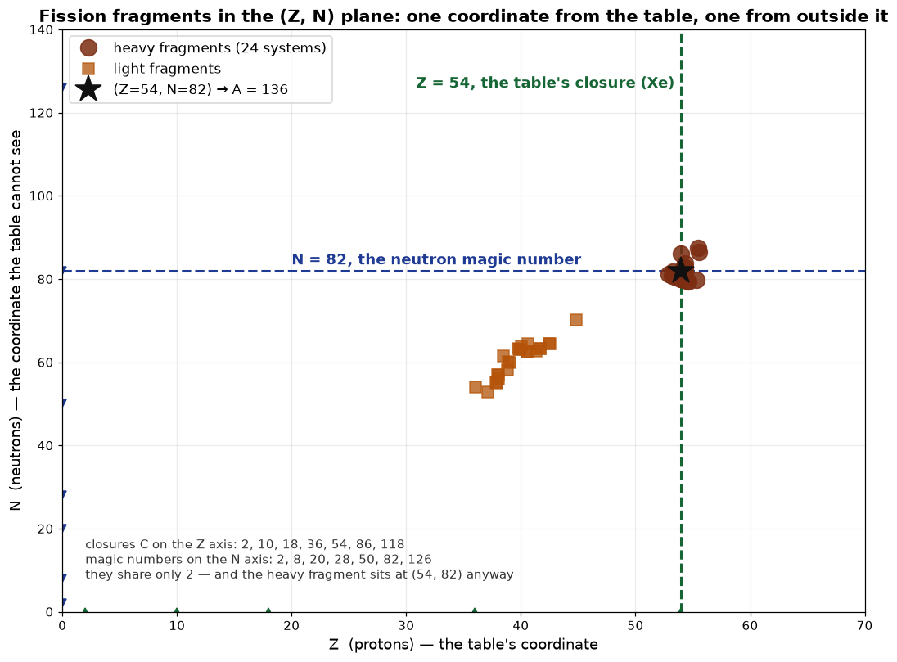

# Atom, nucleus, or smaller? What the prime ladder is made of — and what fission shows

The question, answered in one line: **the ladder is indexed by the charge $Z$ — the one number an atom and
its nucleus share.** It is not *below* the atom (no electron appears as a count, no neutron, no nucleon
substructure), and it is not *above* it (it is not the mass). Everything else follows from that, and
fission is the experiment that shows it, because a fission fragment is the one place where the two
coordinates are visible at once.

`scripts/atom_or_nucleus.py`, [`tableV8_atom_or_nucleus.csv`](tableV8_atom_or_nucleus.csv).

## 1. The four facts that decide it

**(i) The closures are the noble gases.** $C=2,10,18,36,54,86,118$ $=$ He, Ne, Ar, Kr, Xe, Rn, Og — every
one, no exceptions. So the ladder's arithmetic is built from an **atomic** (electron-shell) fact: the
closures are where the *electrons* close.

**(ii) The pin pins charge, not mass.** Over 24 systems the heavy fragment is

$$Z_H=54.14\pm0.62\ (\text{range }52.86\text{–}55.51),\qquad A_H=135.8\pm2.5\ (\text{range }134\text{–}143),$$

i.e. a relative spread of **1.15% in charge against 1.85% in mass number** — the mass scatters **1.61×
more**. What the table fixes is the proton count.

**(iii) The same fragment sits at the neutron magic number — a coordinate the table cannot see.**

$$N_H=A_H-Z_H=81.7\pm2.2\qquad\text{against the magic number }82\ (\text{offset }-0.3).$$

The proton closures and the neutron magic numbers share **only 2** (2,10,18,36,54,86,118 against
2,8,20,28,50,82,126) — and yet the heavy fragment lands at $Z=54$ *and* $N=82$ simultaneously. That is
not a coincidence of one ladder; it is the fragment $^{136}$Xe, doubly closed, and the fission heavy peak
is known to be anchored there.

**(iv) And $Z+N$ recovers the mass number the table cannot see:** $54+82=136$ against $A_H=135.8\pm2.5$
(offset $-0.2$). The one number the table is blind to comes back as the sum of the two it is not.

## 2. So what does "element" mean in this table?

Three readings, and the record supports exactly one:

| reading | evidence for | evidence against | verdict |
|---|---|---|---|
| **smaller than the atom** (nucleons, quarks) | the pin is a *nuclear* process landing on 54 | no neutron ever appears as a count; no substructure in the arithmetic; the closures are noble gases, an electron fact | **no** |
| **the atom** (charge + electrons) | closures = noble gases; $h$/block order electronegativity within a block ($-0.67$ to $-0.92$) | electrons never appear as counts; the heat (a lattice property) does not follow $h$ ($+0.02$, $-0.07$) | **partly** — the *labels* are electronic, the *count* is not |
| **the charge — the number atom and nucleus share** | the pin pins $Z$ 1.6× tighter than $A$; $Z+N$ recovers $A$; every closure is a noble gas | — | **this one** |

So an "element" in this table is not a lump of matter and not a bag of nucleons: it is **a value of $Z$,
with a shell position $h$**. That is why the same integer can carry both the chemistry (through $h$:
block, holes, electronegativity) and the fission pin (through 54): they are one number seen from two
sides — the atom's from outside, the nucleus's from inside.

## 3. Fission, read from the primes

The prime side contributes **arithmetic, not dynamics**. What transfers:

1. **the closure**: $54=C(5)$ is the closure, so a heavy fragment at 54 sits at $h=0$ — the exact statement
   behind the measured $\langle Z_H\rangle=53.96\pm0.09$ (`pin`);
2. **the partner**: the light piece is $Z-54$, so the ratio $Z_L/Z_H=(Z-54)/54$ is a function of the parent
   alone — $0.667$ at Th to $0.852$ at Fm, which is what the 24 systems show;
3. **the closed/open verdict**: the heavy is always closed; the light is closed only at $Z_L\in\{36,37,38\}$
   — hence the closed-pair share $0.357$ (Th) → $0.000$ for $\langle Z_L\rangle\ge39.8$ (G3 in
   [`key-correlations.md`](key-correlations.md));
4. **the mode ordering**: $h_{\rm sym}=54-Z/2$ orders the mode within each excitation class
   (Spearman $-0.80$ to $-0.89$), while $Z^2/A$ does not.

What does **not** transfer, and the record says so three times over:

* **energy** — a mass law linear in $Z$ prices every split at its intercept, 8.72 GeV for a 200 MeV
  process (`linear_mass_law_blind`); the energy is the mass excess, which depends on $A$, hence on $N$;
* **the neutron multiplicity** — $\nu$ comes only from the balance $A-A_1-A_2$ (2.40 to 4.09); the table
  has no place for it;
* **the yields** — the yield distribution is a smooth charge distribution, not an arithmetic one;
* **the dynamics** — the prime side's $\log^2p$ law has no fission analogue at all; that is the honest
  boundary between the two channels.

## 4. The one sentence

The primes give the fission **positions** (a closure and its complement) and the **verdicts** (closed or
open, ratio, ordering) exactly; they give the fission **energy**, **yields** and **neutron number** not at
all — because the ladder is a charge coordinate, and fission needs the second coordinate too. The heavy
fragment at $(Z,N)=(54,82)$ is the picture of that: one axis from the table, one from outside it, and
$A=136$ as their sum.
