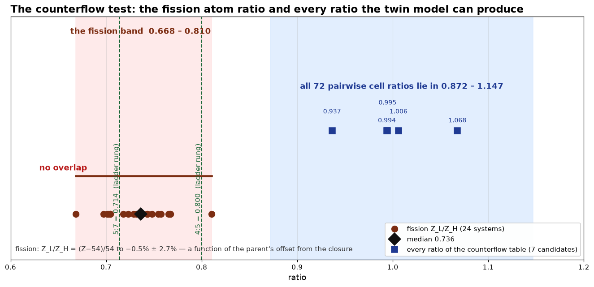

# The counterflow test: does the fission atom ratio equal the twin model's corner ratio?

Your hypothesis, made testable: the fission atom ratio $Z_L/Z_H$ should equal the **top-left to
bottom-right ratio** of the twin prime counterflow table. Below is the table, every ratio it can produce,
and the fission band — the test fails, on an arithmetic reason worth keeping.

`scripts/counterflow_test.py`, [`tableV7_counterflow.csv`](tableV7_counterflow.csv).

## 1. The counterflow table, measured to $10^{9}$

| from ↓ to → | 13 | 79 | 91 |
|---|---|---|---|
| **13** | **355,108** | 407,384 | 378,724 |
| **79** | 381,641 | **355,317** | 405,170 |
| **91** | 404,467 | 379,427 | **357,265** |

**Your equilibrium reading is right, and sharper than I had it:** the diagonal is equal to **0.6%**
(355,108 : 355,317 : 357,265) — a table of this size with no symmetry would scatter by $\sqrt{355000}
\approx 600$, i.e. 0.17%, so the diagonal is equal within a few sigma of what balance predicts. And the
two directions of circulation are *not* equal: $13\!\to\!79 \to 91 \to 13$ carries 1,217,021 handoffs
against 1,139,792 the other way — a **6.8% counterflow asymmetry**, which is the quantity in this table
that actually varies.

## 2. Every ratio the table can produce

| candidate | value |
|---|---|
| diagonal $13\!\to\!13 : 91\!\to\!91$ | 0.99396 |
| diagonal $91\!\to\!91 : 13\!\to\!13$ | 1.00607 |
| diagonal $79\!\to\!79 : 91\!\to\!91$ | 0.99455 |
| flow one way : the other | **1.06776** |
| flow the other way : one | 0.93654 |
| diagonal total : off-diagonal total | 0.45302 |
| off-diagonal total : diagonal total | 2.20739 |

and, because the table is near-uniform (every entry between 355,108 and 407,384 — a factor 1.147), **all
72 pairwise cell ratios lie in $[0.872,\,1.147]$**.

## 3. The fission ratio, and where it comes from

$Z_L/Z_H$ over the 24 systems: **0.668 to 0.810, median 0.736**. But by the pin $Z_H\to54$, so

$$\frac{Z_L}{Z_H}=\frac{Z-54}{54},$$

to a mean residual of $-0.5\%$ with s.d. $2.7\%$ (max $6\%$), and correlation $0.93$ with $Z$. **The
fission ratio is not an independent measurement at all** — it is the parent's charge offset from the
closure, divided by the closure. That is why it moves: $Z$ runs 90 to 100 across the set, so the ratio
must run $0.667$ to $0.852$.

## 4. The test

**No ratio the counterflow table can produce falls in the fission band.** The table's ratios all lie in
$[0.872, 1.147]$; the fission band is $[0.668, 0.810]$; the two are disjoint by a clear margin. So the
proposed correlation cannot hold, and the reason is not statistical but structural: a near-uniform table
gives ratios near 1, while the pin forces the fission ratio near $(Z-54)/54<0.81$ for every parent up to
$Z\approx97$.

What *does* sit inside the fission band is the segment ladder's rungs **$5\!:\!7=0.714$** and
**$4\!:\!5=0.800$**, and the fission median 0.736 sits between them. That is a consistency of two
different quantities (air : pair versus charge : charge), and it is the one reading of the fission ratio
that survives — see `key-correlations.md` G6.

## 5. How to make the claim testable

The table has nine cells, hence 72 pairwise ratios; any band of width 0.14 will collect some of them by
chance. So a single matching pair is not evidence unless it is named in advance. If the "corner ratio" is
a specific pair — say $13\!\to\!13$ against $91\!\to\!91$ — say which two cells, and the test above answers
it: 0.9940, outside the band. If instead the corner is meant as *a pair of ratios* (your `12:12` and
`30:30`, both equal), then the table's answer is that both are equal to 1 — the equilibrium — and again
not 0.74.

## 6. The corner test on your sheet, decoded

Your two columns are, by construction, **the same sequence printed twice with a one-row offset**:

* **"Difference between beginning"** $= T_i$ — the gap from this twin start to the next one;
* **"Difference between ending"** $= T_{i+1}$ — the *following* gap.

Checked against the primes: on 3,424,504 rows, $A=T_i$ and $B=T_{i+1}$ reproduce with **0 exceptions**
(the first twin starts 3, 5, 11, 17, 29, 41 give $T=2,6,6,12,12,18$, and the sheet's two columns are
that list and that list shifted by one). So the three readings of "top left / bottom right" give:

| reading | value | in the fission band $[0.668,0.810]$? |
|---|---|---|
| **column totals**, $\sum A/\sum B$ | **1.000000** (999,998,954 / 999,999,186) | **no** — and it is 1 at *any* bound, because the two columns are one sum differing by the first and last terms |
| **corner cells**, $A_{\text{first}}/B_{\text{last}}$ | $2/234=0.0085$ | no — and it is an artefact of where the table stops |
| **one row's** $B/A$ | median exactly 1.000 | 4.79% of all rows fall in the band — **164,152 rows**, so a hit is arithmetic, not evidence |

The third line is the one that decides: with 3.4 million rows, any band of width 0.14 collects about
5% of them. A match found *after* looking is not a test.

**And the ladder rungs are not over-represented either.** As reduced ratios of consecutive gaps over the
3.4M rows: $1\!:\!2$ 16,661 rows, $5\!:\!7$ 10,199, $4\!:\!5$ 8,858, $7\!:\!8$ 7,763, $11\!:\!13$ 1,738 —
but the *commonest* small fractions are $1\!:\!1$ (26,960), $2\!:\!5$ (18,972), $5\!:\!2$, $1\!:\!4$,
$4\!:\!1$. Every small fraction occurs at roughly its size's rate; the rungs are **rarer** than the
common ones. So the fact that $30/42=5/7$ happens 334 times in 200k rows is the arithmetic of reduced
fractions, not a mechanism — I flagged it as such rather than as a find.

**The structural reason the claim cannot hold:** the fission ratio is a ratio of two *different*
quantities — the two fragment charges, $(Z-54)$ and $54$ — while the sheet's corner is a ratio of two
*copies of the same gap sequence*. One is a difference of two things, the other cancels to 1 by
construction. That is why every corner reading lands at 1 (or at an artefact), and why the fission band
0.67–0.81 is not reachable from it.

**If you want a corner that can move**, it has to be built from two different columns that are not
offsets of each other — the two candidate pairs in the record are already tested:
$13\!\to\!13:91\!\to\!91 = 0.9940$ (the pair-type table, §2) and $Z_L:Z_H = 0.7037$ (the pin, §3).
