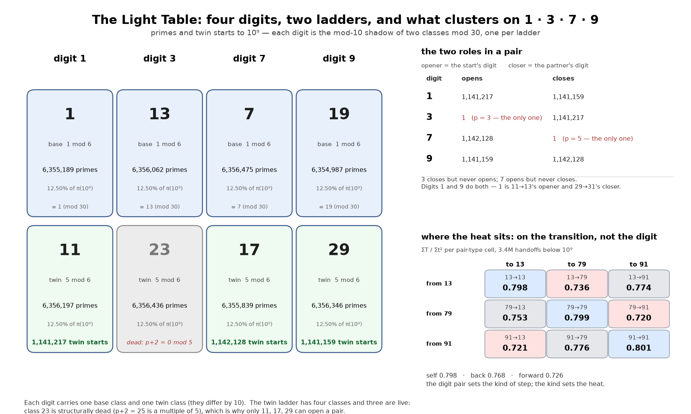

# The Light Table: what clusters on 1 · 3 · 7 · 9



The four end digits are not four classes. Each is the mod-10 shadow of **two** classes mod 30 — one on
each ladder — and the digits play two different roles in a twin pair. That is the whole of the new
table, and the two facts are proved (`results/digit-roles.lean`, 11 theorems) rather than read off.

| digit | classes mod 30 | ladder of each | opens a pair | closes a pair |
|---|---|---|---|---|
| **1** | 1, 11 | base (1), twin (5) | 1,141,217 (at 11) | 1,141,159 (at 29) |
| **3** | 13, 23 | base (1), twin (5) | **1 — only $p=3$** | 1,141,217 (at 13) |
| **7** | 7, 17 | base (1), twin (5) | 1,142,128 (at 17) | **1 — only $p=5$** |
| **9** | 19, 29 | base (1), twin (5) | 1,141,159 (at 29) | 1,142,128 (at 19) |

Measured to $10^{9}$: 50,847,534 primes and 3,424,506 twin starts; `scripts/digit_table.py`,
[`tableV2_digit_table.csv`](tableV2_digit_table.csv). Counts per class are equal to the last digit —
6,354,987 to 6,356,475, i.e. 12.50% each, a spread of 0.02%.

## 1. What the table does to the four digits

**Every prime above 5** sits in one of eight classes; the digit is a two-to-one shadow
(`two_classes_per_digit`), and the two classes under a digit are always one base-ladder and one
twin-ladder class (`digit_splits_ladder`):

$$\text{digit }1:\ 1\ (\text{base})\ \big|\ 11\ (\text{twin})\qquad
\text{digit }3:\ 13\ \big|\ 23\qquad
\text{digit }7:\ 7\ \big|\ 17\qquad
\text{digit }9:\ 19\ \big|\ 29 .$$

So a digit can never tell you which ladder you are on. That is why the record's "1·3·7·9 scale" needs the
mod-30 class beside it, and why the two "grooves" of a crossing differ by 10.

**Twin starts** are not spread over the four digits: they are exactly the three classes 11, 17, 29
(`twin_start_mod_30`), whose digits are 1, 7, 9 (`twin_start_digit`). So:

* **digit 3 never opens a pair** (`three_never_opens`) — its twin class 23 is *dead*, because
  $23+2=25$ (`no_twin_at_23`). The twin ladder has four classes and three are live.
* **digit 7 never closes a pair** (`seven_never_closes`) — a partner ending in 7 needs a start ending
  in 5, i.e. $p=5$.
* each impossibility happens **exactly once**, at the two smallest pairs: $(3,5)$ opens on 3, $(5,7)$
  closes on 7 (`the_two_exceptions`). Nothing else in the sequence does either.
* the pair types are therefore $(1,3)$, $(7,9)$, $(9,1)$ (`pair_types`), and the pair's digit step is
  $+2 \pmod{10}$ (`pair_digit_step`), which is why 9 closes into 1.

**The heat does not cluster on a digit; it clusters on the transition.** The nine pair-type cells carry
$\Sigma T/\Sigma t^2$:

| | to 13 | to 79 | to 91 |
|---|---|---|---|
| from 13 | **0.798** (self) | 0.736 (forward) | 0.774 (back) |
| from 79 | 0.753 (back) | **0.799** (self) | 0.720 (forward) |
| from 91 | 0.721 (forward) | 0.776 (back) | **0.801** (self) |

Self $0.798$, back $0.768$, forward $0.726$ — the same numbers the record measured, now beside the digit
column that produces them. The step kind is a function of the two digits; the heat is a function of the
step kind. So the answer to "what clusters on 1, 3, 7, 9" is: **counts cluster by class, roles by digit,
and heat by transition** — three different groupings, and confusing them is the error the table exists to
prevent.

## 2. What the table carries from the rest of the record

| column of the table | which relation it carries | status |
|---|---|---|
| class (mod 30) | the wheel, $8=\varphi(30)$ classes, equal share to 0.02% | proved + measured |
| ladder | $P=B+K+2$: each digit splits one base and one twin class (R18) | proved |
| twin starts | $N\le K+1$, twin classes 11, 17, 29 (R19, R20) | proved |
| air after a twin start | air $\equiv4\pmod 6$; the air class is fixed by the type transition (R21) | proved |
| heat per cell | H8: $\Sigma T/\Sigma t^2$ is the cell's specific heat | measured |
| span | R34: $p_N-p_1=(2C_2)^{-1}\sum\log^{2}p_i$, 0.022% at $10^{9}$ | proved given the measured constant |

## 3. What it means, in three sentences

1. **A digit is not a class.** It is two classes, one per ladder, and every count in the table is a class
   count — which is why quoting a digit without its mod-30 class loses half the information.
2. **The dead class 23 is the mechanism behind "3 can only close".** The record read that off the
   sequence; here it is the arithmetic $23+2=25$, and it is why the openers are three digits and the
   closers are three different ones.
3. **The heat belongs to the transition.** Any attempt to attach a specific heat to a digit, rather than
   to a pair of digits, will average the three kinds together and lose the 10% spread.

## 4. And the class of a segment, from its own digits

The same residue arithmetic isolates a segment's class from the *gaps it contains*: with `cls` the
digit→class map above, a segment of $k$ pairs has class $\bigl(2k+\sum \operatorname{cls}(a_i \bmod 10)\bigr)
\bmod 30$ — proved (`air_class_of_digit`, `total_class_from_digits`) and checked with 0 exceptions on
218,241 segments ([`class-from-digits.md`](class-from-digits.md)).

## 5. Reproducing it

```
python3 scripts/digit_table.py            # the class and digit counts, 13 s
python3 scripts/light_table_figure.py     # results/light-table.png
lean results/digit-roles.lean             # the 11 theorems
```
