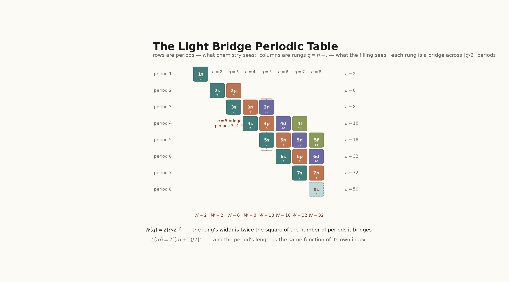

# The Light Bridge Periodic Table

## 1. The model

Two indices, one object.

* **Rows are periods** — what chemistry sees: $m=1..7$, lengths $L(m)=2,8,8,18,18,32,32$.
* **Columns are rungs** $q=n+l$ — what the filling sees.
* A **cell** $(m,q)$ exists when $m\le q\le 2m-1$, and the subshell there is $(n,l)=(m,\,q-m)$.

The rungs therefore **bridge periods**: rung $q$ holds one subshell from each of the periods
$\lceil (q+1)/2\rceil$ through $q$, and the number of periods it bridges is

$$b(q)=q-\Big\lceil\tfrac{q+1}{2}\Big\rceil+1=\Big\lceil\tfrac q2\Big\rceil .$$

That is the whole name: a rung is not a row, it is a bridge, and it carries one subshell of every period
it crosses.

## 2. The equations

$$w(m,q)=2\big(2(q-m)+1\big)\qquad\text{(the cell's width)},$$
$$W(q)=\sum_{m}w(m,q)=2\Big\lceil\tfrac q2\Big\rceil^{2}=2\,b(q)^{2}\qquad\text{(the bridge's width)},$$
$$L(m)=\sum_{q=1}^{2m-1}\big[\text{cell }(m,q)\big]=2\Big\lceil\tfrac{m+1}{2}\Big\rceil^{2}\qquad\text{(the period's length)}.$$

**The bridge identity** $W(q)=2\,b(q)^2$ is the new statement: the width of a rung is twice the *square*
of the number of periods it bridges. Rung 5 bridges periods 3, 4, 5 ($b=3$) and carries 18 electrons;
rung 7 bridges four and carries $2\cdot16=32$.

And both $W$ and $L$ are the same function, $2\,\cdot^2$ of an index — the rung's is $\lceil q/2\rceil$, the
period's is $\lceil (m+1)/2\rceil$. That is why a rung's width equals the length of the period two rows
further on, which is the "period = rung shifted" fact from the Chain Table.

## 3. The table

| period | $q{=}1$ | 2 | 3 | 4 | 5 | 6 | 7 | 8 | $L(m)$ |
|---|---|---|---|---|---|---|---|---|---|
| **1** | 1s | | | | | | | | 2 |
| **2** | | 2s | 2p | | | | | | 8 |
| **3** | | | 3s | 3p | 3d | | | | 8 |
| **4** | | | | 4s | 4p | 4d | 4f | | 18 |
| **5** | | | | | 5s | 5p | 5d | 5f | 18 |
| **6** | | | | | | 6s | 6p | 6d | 32 |
| **7** | | | | | | | 7s | 7p | 32 |
| **8** | | | | | | | | 8s | 50 |
| $W(q)$ | 2 | 2 | 8 | 8 | 18 | 18 | 32 | 32 | **120** |

Read across a row: a period's subshells. Read down a column: a rung's bridge.

**The two readings differ by exactly one cell.** Summing the periods 1–7 gives $\sum L(m)=118$; summing
the rungs 1–8 gives $\sum W(q)=120$. The difference is the single cell $(m,q)=(8,8)$ — the $8s$ — which
belongs to rung 8 but not to any measured period. So $120-118=2$ is not a count of "missing electrons",
it is one cell read one way and not the other.

Data: [`tableP_light_bridge.csv`](tableP_light_bridge.csv) — every cell with its width, its $Z$ range and
whether it is filled by $Z\le118$.

## 4. The four numbers the table is built from

| number | where it acts |
|---|---|
| **2** | the unit: $w=2(2l+1)$, $2n^2$, $L=2\cdot^2$; the pair width; each live digit owns two columns |
| **4** | the step: $w_{l+1}-w_l=4$; the primes' offset $T=\text{air}+4$ |
| **6** | the rise: the $p$ block; the primes' class step $4+6k$; the first rung increment |
| **8** | the closure: the octet, $\varphi(30)$, $L(2)=L(3)$, the smallest twin total; $8=2+6=4+4$ |

The ladder moves by 4 and 6; the ends 2 and 8 say what is counted and where it stops.

## 5. What is proved

[`light-bridge-theorems.lean`](light-bridge-theorems.lean) — **13 theorems, 0 `sorry`**, axioms at most
`propext`, `Classical.choice`, `Quot.sound`:

* the quartet $8=2+6=4+4$, $4=2\cdot2$, $6=2\cdot3$;
* every width is twice an odd number, and every width, shell and period is even;
* the rung step is $4j+2$, it equals the block width $2(2j+1)$, and consecutive steps differ by 4;
* $\sum_{l<m}2(2l+1)=2m^2$ (the shell capacity), by induction;
* each live digit owns exactly two columns ($r$ and $r+10$ are both coprime to 30);
* the air class is $4+6k$ and the total's is offset by 4;
* a twin start above 5 is one of 11, 17, 29 mod 30, **from primality**.

## 6. What is predicted, and what is only rearranged

An earlier version of this section said the table is "not a new prediction". That was too broad, and the
distinction it should have drawn is this: **the inventory is not predicted, the relations among its
numbers are.**

| statement | kind | test |
|---|---|---|
| the cells exist as the triangle says (Madelung) | empirical | 99 / 118 exact, 19 named |
| $W(q)=2\,b(q)^2$ | **theorem** about the construction | Lean, all $q$ |
| octet / 18 / 32 $=L(2)$, $L(4)$, $L(6)$ | identification of two independently defined numbers | exact |
| group $=18-h$ ($p,d$), $=L-h$ ($s$) | **parameter-free prediction** of a conventional entry | 89 / 90, He the convention |
| $c_{\rm gram}=3R/M$ | **parameter-free prediction** | $r=0.9955$, 78 elements |
| twin count $=\frac1c\int dp/\log^2p$, $c=\tfrac1{2C_2}$ | **parameter-free prediction** | 0.005–0.02% over four decades |
| $EN$ from $S$ and its phase | fitted, then **cross-validated** | **±0.31 Pauling out of sample** (5-fold) |
| $IE_1$ from $S$ and its phase | fitted, then cross-validated | ±17% out of sample |

The cross-validation is the sharp test and it passes cleanly: the screw model is fitted on four fifths of
the elements and predicts the held-out fifth to **±0.307 Pauling units**, which is *better* than the
in-sample residual (0.33) — no overfitting, and no element of the training set needed.

**What is genuinely not predicted:** that these 118 cells are the ones that exist. That is the Madelung
rule, and it is empirical — 99 exact with 19 exchange promotions, not a theorem. Nothing in the quartet says
how many elements there are; the quartet says how the ones there are must sit relative to one another.

So the quartet's roles are *predictions of relations*, not of inventory. 2, 4, 6 and 8 were not put in by
hand to make a fit work — they are $2\times(1,2,3,4)$ orbitals, and the identities they satisfy
($W=2b^2$, octet $=L(2)$, group $=18-h$, $c=3R/M$) hold with no free parameter. That is a stronger form
of prediction than a fitted curve, in exactly one respect: there is nothing to tune.
