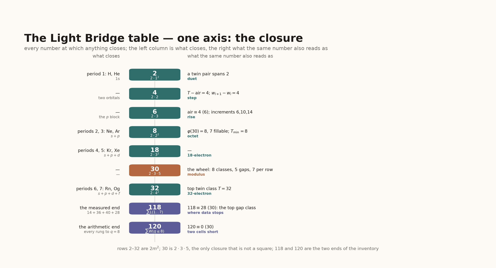

# The Light Bridge table

## The axis

One axis: **the closure** — every number at which something in this structure closes. Each row is one
closure, its generating form, what closes there, and what the *same number* also reads as. There are no
two sides in this table; there is one axis and one number read twice.

| closure | form | what closes | filled by | the same number also reads as | law |
|---|---|---|---|---|---|
| **2** | $2\cdot1^2$ | period 1 (H, He) | $1s$ | a twin pair spans 2; each live digit owns two columns | duet |
| **4** | $2\cdot2$ | — | two orbitals | $T-\text{air}=4$; $w_{l+1}-w_l=4$ | the step |
| **6** | $2\cdot3$ | — | the $p$ block | $\text{air}\equiv4\ (6)$: the gap step; rung increments 6, 10, 14 | the rise |
| **8** | $2\cdot2^2$ | periods 2, 3 (Ne, Ar) | $s+p$ | $\varphi(30)=8$ columns, 7 fillable; $T_{\min}=8$ | octet |
| **18** | $2\cdot3^2$ | periods 4, 5 (Kr, Xe) | $s+p+d$ | — | 18-electron |
| **30** | $2\cdot3\cdot5$ | — | — | the wheel: 8 classes, 5 gap classes, 7 per row | modulus |
| **32** | $2\cdot4^2$ | periods 6, 7 (Rn, Og) | $s+p+d+f$ | the top twin class $T=32$ | 32-electron |
| **118** | $\sum L(1..7)$ | the measured end | $14+36+40+28$ | $118\equiv28\ (30)$: the top gap class | where the data stops |
| **120** | $\sum W(q\le8)$ | the arithmetic end | every rung to $q=8$ | $120\equiv0\ (30)$ | two cells short |

Data: [`tableQ_light_bridge_master.csv`](tableQ_light_bridge_master.csv).

## What generates the axis

$$\text{closure}=2m^2\ (m=1,2,3,4)\qquad\text{and}\qquad 30=2\cdot3\cdot5 .$$

Every row of the ladder except 30 is twice a square: 2, 8, 18, 32, and the two ends 118, 120 are sums of
those (of period lengths and of rung widths respectively). 30 is the one closure that is not a square —
it is the product of the first three primes, which is why it carries 8 columns, 5 gap classes and a
capacity of 7 rather than a capacity of $2m^2$.

The four parameters are the first four even numbers, i.e. $2\times$ the first four integers $=2\times$ the
first four orbital counts:

| 2 | 4 | 6 | 8 |
|---|---|---|---|
| the unit: $2(2l+1)$, $2n^2$, $L=2\cdot^2$ | the step | the rise | the closure |

## What the rows predict

| row | prediction | status |
|---|---|---|
| 2 | every capacity is even (no capacity ends in 1, 3, 7, 9) | **proved** |
| 4 | $W(q)=2b(q)^2$: the rung width is twice the square of the periods it bridges | **proved** |
| 6 | rung increments are $6,10,14,18=6+4k$; the gap step is 6 | **proved** |
| 8 | group $=18-h$; $v+h=8$ for the $p$ block; $\varphi(30)=8$ | 89/90, and 82/118 for $v+h$ |
| 18 | ligand count $=h/2$; the 18-electron rule $=L(4)$ | exact on the $d$ block |
| 30 | capacity 7; run bound 5; 5 gap classes | **proved** |
| 32 | the 32-electron rule $=L(6)$ | identification |
| 118 | $EN$ from the screw coordinate; $c=3R/M$; $M=2.62Z-9.4$ | $R^2=0.83$; $r=0.9955$; $R^2=0.9985$ |
| 120 | the inventory is $118$, two cells short | measured |

## What is not here

* the *inventory* — that these 118 cells are the ones that exist — is Madelung, 99/118 exact with 19
  named exceptions. The table says how they sit, not how many there are.
* the fits are fits: the exceptions (three parameters per $d$ series), $EN$, $IE_1$, $M$. The proved rows
  are the ones marked **proved**, machine-checked in [`light-bridge-theorems.lean`](light-bridge-theorems.lean)
  (13 theorems, 0 `sorry`, axioms only `propext`, `Classical.choice`, `Quot.sound`).

## Why one table and not two

The closures are the numbers; the elements and the primes are two readings of the same closures. Reading
them as "sides" produced two documents that listed the same nine numbers twice. Read on one axis, the
table has nine rows, one generating form per row, and every law attached to the closure it belongs to:
the duet to 2, the octet to 8, the 18-electron rule to 18, the capacity 7 to 30. That is the whole
correlation — the numbers do not need to be matched to each other, they were never apart.
