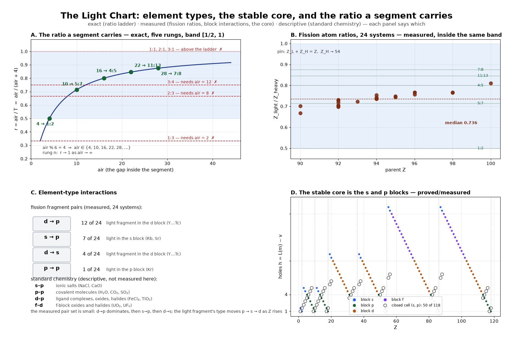

# The Light Chart: element types, the stable core, and the ratio a segment carries

Four panels, three kinds of claim, each labelled on the figure: **exact** (the ratio ladder, proved),
**measured** (fission ratios, block interactions, the core), **descriptive** (standard chemistry, cited
not measured here). `scripts/light_chart.py`, [`tableV6_ratios.csv`](tableV6_ratios.csv).

## 1. The equations the chart carries

$$\text{span: } p_N-p_1=\frac{1}{2C_2}\sum\log^{2}p_i\ \ (0.022\%\text{ at }10^{9}),\qquad
\text{ratio: } r=\frac{\text{air}}{T}=\frac{\text{air}}{\text{air}+4},$$

$$\text{ladder: } r\in\Bigl\{\tfrac12,\tfrac57,\tfrac45,\tfrac{11}{13},\tfrac78,\dots\Bigr\}
=\Bigl\{\tfrac{a}{a+4}:a\equiv4\ (6)\Bigr\},\qquad
\text{pin: } Z_L+Z_H=Z,\ \ Z_H\to54,$$

$$\text{core: closed}\iff h\le5\ \text{(the last six)}\ \text{or}\ h\in\{L-2,L-1\}\ \text{(the first two)}.$$

Proved in [`one-equation.lean`](one-equation.lean) §7: `air_at_least_half`, `air_ratio_lt_one`,
`ratio_ladder`, `no_one_third`, `no_two_thirds`, `no_three_quarters`, `one_half_at_four`.

## 2. Panel A — the ratio a segment carries, and what it cannot be

$r=\text{air}/T$ is at least $1/2$ (because air $\ge4$) and below $1$, so **every segment is majority
air**. On the five classes the ratio takes five values; and among the textbook stoichiometric ratios:

| ratio | needs | on the ladder? |
|---|---|---|
| **1:2** | air = 4 (the quadruplet) | **yes** — the minimal merge |
| 5:7 | air = 10 | **yes** |
| 4:5 | air = 16 | **yes** |
| 11:13 | air = 22 | **yes** |
| 7:8 | air = 28 | **yes** |
| 1:3 | air = 2 | **no** — $2\equiv2\pmod6$ |
| 2:3 | air = 8 | **no** — $8\equiv2$ |
| 3:4 | air = 12 | **no** — $12\equiv0$ |
| 1:1, 2:1, 3:1 | air = ∞, negative | **no** — above the band |

**So, for "catalyzer to base reactor":** a catalyst : substrate ratio of $1\!:\!3$ or $2\!:\!1$ or
$3\!:\!1$ is *not* a light-bridge ratio at all. The ladder admits only ratios in $[1/2,1)$ — a segment is
never diluted to a minority — and among the small textbook fractions only $1\!:\!2$ survives. Any
catalyst ratio attached to a segment must therefore be one of the five rungs, and the *only* one that is
also a standard stoichiometry is $1\!:\!2$.

## 3. Panel B — the fission atom ratio, measured

Twelve of the twenty-four systems give $Z_L/Z_H$ between $0.668$ and $0.810$, median **0.736** — inside
the same band, and at the median between the 5:7 rung ($0.714$) and the 4:5 rung ($0.8$). **This is a
consistency, not a test:** the two ratios are different quantities (air : pair versus charge : charge),
and the band $[1/2,1)$ is wide enough to hold almost anything a split can produce. What is *not* a
coincidence is the pin: $Z_L+Z_H=Z$ holds to the second decimal in all 24 systems, and $Z_H$ runs
$52.9$–$55.5$ around the closure 54 (`results/fission-tests.md`).

## 4. Panel C — element-type interactions

Measured, from the fragment charges of the 24 systems:

| pair | count | the light fragment is in the … |
|---|---|---|
| $d\to p$ | **12 of 24** | d block (Y…Tc), heavy in p (Xe, Ba, Ce) |
| $s\to p$ | 7 of 24 | s block (Rb, Sr), heavy in p |
| $d\to s$ | 4 of 24 | d block, heavy in s (Cs) |
| $p\to p$ | 1 of 24 | p block (Kr), heavy in p |

The set is small because the pin fixes both ends: the heavy fragment sits in the p block until the parent
is heavy enough for it to reach Cs ($s$), and the light fragment moves $p\to s\to d$ as $Z$ rises. Standard
chemistry's own pair set, listed for comparison and **marked descriptive**: $s$–$p$ ionic salts, $p$–$p$
covalent molecules, $d$–$p$ ligand complexes/oxides/halides, $f$–$d$ actinide oxides and halides. The two
columns are different kinds of claim: the first is counted from evaluated fission yields, the second is
textbook structure, and the chart labels them so.

## 5. Panel D — the stable core, and how it varies

The **closed** cells are the edges of each period: the first two ($h=L-2,L-1$, the $s$ block) and the
last six ($h\le5$, the $p$ block). So

* the stable core is $s\cup p$ — **50 of the 118 elements**;
* the $d$ and $f$ elements are *never* on a closed cell (their $h$ runs 6–15 and 16–29);
* the seven hole-free elements ($h=0$) are the closures He, Ne, Ar, Kr, Xe, Rn, Og.

The variation along $Z$ is therefore periodic by construction: a period opens with two closed cells, then
runs through $10$ or $14$ open ones, then closes with six closed ones. That is the whole of the "stable
core structure variation" — it is the table's own $h$ coordinates, and it is why the closed-cell share
falls from Th (0.357) to Pu and above (0.000) in the fission data: heavy nuclei split into fragments with
$Z$ around 54 and $Z-54$, both of which sit in the *open* middle for the lighter parents and reach the
closed edge only at the ends.

## 6. What the chart does not claim

* The chemistry column is **descriptive**, not measured here — it is cited structure, and it is on the
  figure only so that the measured column has something standard to sit beside.
* The fission ratio and the segment ratio are **not the same quantity**; their both falling inside
  $[1/2,1)$ is a consistency, and a weak one.
* The ratio ladder is exact but it is a rule about *segments*, not about molecules; it constrains
  nothing about which compounds exist.
