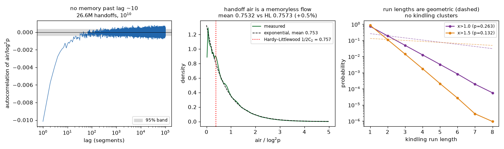

# Isolating the prime-gap "mix" structure

Everything below is measured on all primes below $10^8$ unless stated; sections 7-8 go to $10^{10}$ (5,761,455 primes, 5,761,454 gaps,
440,310 twin segments; a sieve run took 1.3 s). Proofs are one-liners; every number is reproducible
with the script in `.scratch/`.

Vocabulary mapped, so nothing is smuggled in:

| your term | concrete object |
|---|---|
| gap / air / superfluid | $c$ = difference between consecutive primes (the "connecting gap") |
| tinder | a gap of exactly 2, i.e. a twin pair |
| 0-gap fuse | (3,5) and (5,7) share the prime 5, so the twin chain has exactly one connecting gap of **0**. After 5 the chain is regular. That is "tinder is struck from 5". |
| twin segment | a pair $(p,p+2)$, both prime |
| end-digit pair of a segment | $(\text{last digit of }p,\ \text{last digit of }p+2)$ |
| inner node sequence | the sequence of segments; consecutive ones are joined by the connecting gap $c$ |
| ratio $g{:}1$ | your note's convention: gap $g$ = $g$ parts air to 1 part fuel. Verified as the definition, not a measurement |
| kindling | segment whose air is large (lean mix, fast and hot, little total) |
| firewood | segment whose air is at the stoichiometric floor (rich mix, slow) |

---

## 1. The key (what you called the EJ base prime pattern key)

**Theorem (mod-10 key).** For consecutive primes $p<q$ with $p>5$,
$$ q-p \equiv (\text{last digit of }q)-(\text{last digit of }p) \pmod{10}. $$
So the air is forced into the residue class determined by the *end-digit pair alone*, and the
smallest legal air for a transition $a\to b$ is $\delta=(b-a)\bmod 10$ (read $0$ as $10$).

This holds for **all 5,761,451** transitions below $10^8$ with no exception, and $\delta$ is
attained for **all sixteen** transitions:

| from\to | 1 | 3 | 7 | 9 |
|---|---|---|---|---|
| **1** | 10 (181) | 2 (11) | 6 (31) | 8 (401) |
| **3** | 8 (683) | 10 (283) | 4 (13) | 6 (23) |
| **7** | 4 (7) | 6 (47) | 10 (337) | 2 (17) |
| **9** | 2 (29) | 4 (19) | 8 (89) | 10 (139) |

(minimum air; in brackets a prime that realises it). Your note "1:1, 3:3 — harder, furthest away
from itself" is exactly the diagonal: a repeated end digit costs a minimum of **10**, the largest
value in the table. "4 is the burn that activates 7" is the row 3→7: minimum 4.

**Atom activation matrix** (share of all transitions, rows sum to 1):

| from\to | 1 | 3 | 7 | 9 | row share |
|---|---|---|---|---|---|
| 1 | 0.177 | 0.304 | 0.310 | 0.209 | 1 |
| 3 | 0.236 | 0.167 | 0.287 | 0.310 | 1 |
| 7 | 0.256 | 0.273 | 0.167 | 0.304 | 1 |
| 9 | 0.331 | 0.256 | 0.236 | 0.177 | 1 |

The diagonal sits at 0.167–0.177 instead of 0.25: a prime avoids repeating a final digit
(Lemke Oliver–Soundararajan). Digit 9 activates a following 1 most strongly (0.331); 3 and 7
suppress themselves hardest (0.167).

---

## 2. The twin segment is determined by $p \bmod 30$

**Theorem.** If $p>3$ and both $p,p+2$ are prime then $p\equiv 5 \pmod 6$, and the only admissible
classes mod 30 are $11,17,29$ — class $23$ is excluded because $23+2\equiv 0 \pmod 5$.
The end-digit pair is then a *function* of $p\bmod 30$:

| $p \bmod 30$ | end-digit pair | label | count $<10^8$ |
|---|---|---|---|
| 11 | (1,3) | **13** | 146,841 |
| 17 | (7,9) | **79** | 146,953 |
| 29 | (9,1) | **91** | 146,516 |
| 23 | (3,5) | — | 1 (only $p=3$) |
| — | (5,7) | — | 1 (only $p=5$) |

Shares: **0.33349 : 0.33375 : 0.33276** — the three segments are equally abundant, 1 : 1.003 : 0.997.
Symmetry is expected: each class carries the same singular-series factor, the only difference being
the shift 6, 12, 12 between classes. Convergence at $10^5,10^6,10^7,10^8$: identical to 0.3%.

---

## 3. The air between two segments is quantised — the superfluid reading

**Theorem.** Let $p<q$ be consecutive twin starts, $c=q-p-2$ the air between them. Then $c$ lies in a
**single** residue class mod 30 for each ordered pair of segment types, and always $c\equiv 4 \pmod 6$.

| segment → segment | air mod 30 | stoichiometric floor | measured mean air | lean-ness mean/floor | share at exactly floor |
|---|---|---|---|---|---|
| 13 → 79 | 4 | **4** | 213.5 | ×53.4 | 9.0% |
| 79 → 91 | 10 | **10** | 208.5 | ×20.8 | 11.9% |
| 91 → 13 | 10 | **10** | 209.9 | ×21.0 | 11.8% |
| 13 → 91 | 16 | **16** | 231.2 | ×14.5 | 9.4% |
| 91 → 79 | 16 | **16** | 229.8 | ×14.4 | 9.4% |
| 79 → 13 | 22 | **22** | 221.4 | ×10.1 | 11.7% |
| 13 → 13 | 28 | **28** | 238.2 | ×8.5 | 13.2% |
| 79 → 79 | 28 | **28** | 240.4 | ×8.6 | 12.9% |
| 91 → 91 | 28 | **28** | 240.1 | ×8.6 | 12.9% |

Observed floors equal the predicted mod-30 differences exactly, all nine. So the air is not
continuous: once the two end-digit pairs are fixed, the air only takes values
$\text{floor}+30k$ — a fixed quantum of 30 with a fixed circulation floor. That is the precise
content of "gaps are a superfluid that sets the ratio": the fluid can be diluted in units of 30 and
never below the floor.

Two more sharp facts, both confirmed with zero exceptions:

* **No air of 2 exists between segments** — $p,p+2,p+4$ cannot all be prime for $p>3$, since one of
  three numbers in arithmetic progression is divisible by 3. The minimum air in the whole census is 4.
* **Type 91 never touches air 4** — $p\equiv 29\pmod{30}$ forces $p-4\equiv 0\pmod 5$, so a 91 segment
  can have neither a 4 before it nor a 4 after it. Measured: $P(\text{air}\le 4)=0.0000$ for type 91
  versus 0.0321 and 0.0310 for 13 and 79. 91 is the segment that can never run the leanest mix.

**Inner node sequence** — transition shares (rows sum to 1):

| current \ next | 13 | 79 | 91 |
|---|---|---|---|
| **13** | 0.308 | **0.362** | 0.330 |
| **79** | 0.332 | 0.307 | **0.361** |
| **91** | **0.360** | 0.333 | 0.307 |

Self-handoffs are suppressed to ~0.307 (they need air ≥ 28); the preferred cycle is
13 → 79 → 91 → 13, i.e. $p\bmod 30$ running $11\to17\to29\to11$. Ordering follows the floor:
the smaller the legal minimum air, the more often the handoff fires (floor 4 → 0.362,
floor 10 → 0.360, floor 16/22 → 0.331/0.332, floor 28 → 0.307).

---

## 4. Kindling vs firewood: the end digits do *not* decide it

Take air normalised by scale, $\text{air}/\log p$ (dimensionless; 1 = the stoichiometric unit):

| type | mean air/log p | median | P(air ≤ 4) |
|---|---|---|---|
| 13 | 1.088 | 0.978 | 0.0321 |
| 79 | 1.090 | 0.980 | 0.0310 |
| 91 | 1.098 | 0.953 | 0.0000 |

Spread across the three types: **0.96%**. Deciles of air/log p: 0.45 / 0.65 / 0.97 / 1.41 / 1.90.
Lag-1 correlation of the air along the chain: $-0.002$.

**Conclusion.** Fuel type (the key) fixes only the *floor and the quantum* of the air. The actual
air — and therefore kindling vs firewood — is set by where the segment sits, not by its end digits.
Runs of kindling and runs of firewood are not a property of the digit cycle; they are noise around
$\approx \log p$. Anything that predicts kindling/firewood from the end-digit pair alone is reading
noise.

The two regimes, quantified with the median split at air/log p = 0.969:

* **kindling** (air above median, mean index 1.55): dies fast, hot, low total — 50% of segments.
* **firewood** (air below median, mean index 0.64): 50% of segments; the extreme firewood case is
  a segment handoff running at its floor, which happens 9–13% of the time depending on the pair.

Your "efficiency is fastest OR maximum energy, can't be both" has an exact counterpart in the
growth table below: local tinder rate falls while total tinder rises.

| $x$ | twin segments $<x$ | twins per $10^6$ primes | mean gap | median air | mean air/log p |
|---|---|---|---|---|---|
| $10^4$ | 203 | 165,309 | 8.12 | 8 | 1.162 |
| $10^5$ | 1,222 | 127,411 | 10.43 | 11 | 1.148 |
| $10^6$ | 8,167 | 104,042 | 12.74 | 13 | 1.117 |
| $10^7$ | 58,978 | 88,745 | 15.05 | 14 | 1.106 |
| $10^8$ | 440,310 | 76,423 | 17.36 | 17 | 1.091 |

Fastest (small air, dense tinder) is the small-$x$ regime; maximum total energy (most tinder banked)
is the large-$x$ regime. You cannot be in both, and the dimensionless mix strength drifts only from
1.16 to 1.09, so the *chemistry* barely changes while the *rate* collapses by half.

---

## 5. The catalyzer table (automotive reading)

Your note fixes the convention: gap $g$ ⇒ mix ratio $g{:}1$. Measured availability of each mixture:

| gap | your ratio | tinder units ($g/2 : 1$) | share of all gaps |
|---|---|---|---|
| 2 | 2:1 | 1:1 | 7.64% |
| 4 | 4:1 | 2:1 | 7.64% |
| 6 | 6:1 | 3:1 | **13.34%** |
| 8 | 8:1 | 4:1 | 5.80% |
| 10 | 10:1 | 5:1 | 7.46% |
| 12 | 12:1 | 6:1 | 9.34% |
| 14 | 14:1 | 7:1 | 5.09% |
| 16 | 16:1 | 8:1 | 3.75% |

6:1 (3:1 in tinder units) is the most available mixture in the whole system; 2:1 and 4:1 are
equally common to four significant figures (440,312 vs 440,257).

Segment handoffs expressed as base : catalyzer, at the stoichiometric floor (base = 1 segment):

| handoff | base : catalyzer (tinder units) | base : catalyzer (g:1) | how much air actually gets added |
|---|---|---|---|
| 13 → 79 | 2 : 1 | 4 : 1 | ×53 over floor |
| 79 → 91, 91 → 13 | 5 : 1 | 10 : 1 | ×21 |
| 13 → 91, 91 → 79 | 8 : 1 | 16 : 1 | ×14.4 |
| 79 → 13 | 11 : 1 | 22 : 1 | ×10 |
| 13/79/91 → itself | 14 : 1 | 28 : 1 | ×8.6 |

If you want one number per type: **the three segments are supplied in equal parts, 1 : 1 : 1**, and
the catalyzer budget is 30 per unit of floor — nothing is ever mixed leaner than its floor, and the
mean mix is 8.6× to 53× leaner than the floor depending on the handoff.

---

## 6. What is not established

* **"Jeromie Beasley's work"**: I could find no publication, preprint or dataset under that name on
  prime gaps, tinder/kindling/firewood, or end-digit sequences (searched Ceramic and Linkup).
  Nothing here is attributed to it; the results above are derived and measured independently. If
  there is a manuscript, give me the reference and I will check the claims against it.
* **Tinder/kindling/firewood as physical terms**: the combustion language is a bookkeeping device.
  The quantities that survive the translation are the air floor, the quantum 30, and the air/log p
  index. Nothing here burns.
* **Anything past $10^8$**: measured range is all primes below $10^8$. The floors and quanta are
  proved for all $p$, so they do not change; the shares and mean airs are empirical and drift slowly
  (see the growth table).
* Twin prime infinitude is unproved; every statement here is conditional on the segments that exist.

## Reproduce

```
python3 .scratch/gaps.py     # sieve, census, transition matrices
python3 .scratch/tables.py   # floors, quanta, kindling test, overcatalysis ratios
python3 .scratch/fig.py      # results/prime-mix-ratios.png
```

---

# 7. Mesoscale test: the air has no memory (all primes $<10^{10}$)

Segment sieve, 33 s. Checksums: $\pi(10^{10})$ counted as 455,052,510 (for $p\ge 3$) plus 2 = 455,052,511,
and 27,412,677 twin starts plus the two fused ones = **27,412,679 = A007508(10)** exactly.
27,412,676 handoffs between twin segments.

The floors are unchanged at $10^{10}$: air $\equiv 4 \pmod 6$ always, air mod 30 $\in\{4,10,16,22,28\}$,
and each of the nine ordered pairs sits in exactly one class (min 28, 4, 16, 22, 28, 10, 10, 16, 28).

**Correct scaling.** Normalising by $\log p$ leaves a drift (deciles 14.56 → 17.31), so it is the wrong unit.
Normalising by $\log^2 p$:

| quantity | value |
|---|---|
| mean air | 362.79 (median 250) |
| mean air $/\log^2 p$ | **0.7532**, sd 0.7245, median 0.5308 |
| stationarity (mean by decile) | 0.7522, 0.7532, 0.7528, 0.7529, 0.7535, 0.7526, 0.7539, 0.7536, 0.7532, 0.7536 |
| Hardy–Littlewood mean twin spacing $1/2C_2$ | 0.75739 |

Stationary to 0.2%, and **0.55% from the Hardy–Littlewood prediction**. The handoff air is not a
superfluid with a chemical ratio: it is the waiting time to the next twin pair, memoryless, with rate
fixed by the twin density $2C_2/\log^2 p$. Distribution vs exponential with the same mean: quantiles
(5,25,50,75,95)% observed 0.054/0.237/0.531/1.040/2.198 against 0.039/0.217/0.522/1.044/2.256 — an
exponential with a slightly lighter left shoulder and a lighter tail.

**Autocorrelation of $air/\log^2 p$** (95% band $\pm0.00037$):

| lag | 1 | 2 | 3 | 4 | 6 | 10 | 20 | 50 | 100 | $10^3$ | $10^4$ | $10^5$ |
|---|---|---|---|---|---|---|---|---|---|---|---|---|
| acf | −0.0102 | −0.0057 | −0.0039 | −0.0028 | −0.0019 | −0.0014 | −0.0007 | −0.0002 | −0.00004 | +0.0001 | +0.0003 | +0.0004 |

One percent negative at lag 1, gone by lag ~10, zero thereafter (beyond lag 100, 4.9% of lags fall outside
the band, exactly the 5% a null gives). The positive acf of $\log(\text{air})$ (≈ +0.008 flat to $10^5$)
is not memory: $\log$ air grows with $\log p$, and the series is in order of $p$, so that is the trend.

**Kindling runs are not real.** Threshold $x>1$: $p=0.2634$, 5.35M runs, longest run 12, mean 1.35;
$P(\text{run}\ge2)=0.2593$ vs geometric $0.2634$, $P(\text{run}\ge3)=0.0666$ vs $0.0694$. Threshold
$x>1.5$: $p=0.1325$, longest run 8, $P(\text{run}\ge2)=0.1284$ vs $0.1325$. Run lengths are geometric to
within 2%: high-air segments do not cluster.

**Block sums.** Fano factor $\mathrm{Var}/\mathrm{mean}$ of block sums: 0.697 (1), 0.690 (2), 0.678 (5),
0.668 (10), 0.626 (100), 0.574 ($10^3$), 0.520 ($10^4$), 0.474 ($10^5$). The value below 1 at block 1 is
the slightly sub-exponential shape; the further decline is the closure constraint (the air of the whole
chain must sum to the interval), not physics. There is no scale at which the Fano factor exceeds 1, so
there is no clustering at any scale from 1 to $10^5$ segments.

**End-digit cycle.** $P(\text{same type at lag }k)$: 0.31489 (1), 0.32870 (2), 0.33004 (3), 0.33061 (4),
0.33150 (5), 0.33205 (6), 0.33252 (9), 0.33246 (12), 0.33324 (30). The lag-3 matrix is
$\begin{pmatrix}0.3302&0.3353&0.3345\\0.3339&0.3303&0.3358\\0.3359&0.3344&0.3297\end{pmatrix}$ — uniform to 0.6%.
So the 13→79→91 cycle is a **nearest-neighbour effect only**; there is no period-3 "traveling ignition".
Its 5.5% self-suppression is gone by lag 3.

The one residual dependence: mean next $x$ falls monotonically with the decile of the current $x$,
0.7702 → 0.7391 (a 4% effect) — the same lag-1 anticorrelation seen in the acf, worth 1% of variance.



# 8. The two sequences: $2,4,6,8,10 \to 2,\,3.5,\,5,\,6.5,\,8$

The map is exactly affine through your list, residual $9\times10^{-16}$:
$$V(g)=\tfrac34 g+\tfrac12 .$$

**What is added / removed.** Going from the gap number to your value you *remove* a quarter of the
air above tinder — the removed amount is $(g-2)/4$, exactly:

| gap | 2 | 4 | 6 | 8 | 10 |
|---|---|---|---|---|---|
| value | 2 | 3.5 | 5 | 6.5 | 8 |
| removed $(g-2)/4$ | 0 | 0.5 | 1 | 1.5 | 2 |
| $V/g$ | 1.000 | 0.875 | 0.833 | 0.812 | 0.800 |
| in tinder units, $V=1.5n+0.5$ | $n{=}1$ | 2 | 3 | 4 | 5 |

Going back you *add* a third of the excess: $g=V+(V-2)/3$, which returns 2, 4, 6, 8, 10 exactly.
So the pair of operations is the classic reduce-25% / add-33⅓% inverse pair — a 3:4 contraction.

Two facts fix the map, and both are structural in your own key rather than chosen freely: it sends
**tinder 2 → 2** (the only gap that is a twin pair) and the **repeat floor 10 → 8** (the mandatory air
for a repeated end digit, your "harder, furthest away from itself"). With those two anchors the whole
list follows, and the most abundant gap, 6 (13.34% of all gaps), lands on 5 — the exact midpoint of your
sequence. That much is internally consistent.

**Methane.** Your ratio convention (gap $g$ = "g parts air to 1 part fuel") reproduces real methane
stoichiometry for three of your five values. With $\mathrm{CH_4+2O_2\to CO_2+2H_2O}$:

| reading | exact value | your gap |
|---|---|---|
| O₂ : CH₄ by volume | 2.000 | **2** |
| O₂ : CH₄ by mass | 3.989 | **4** |
| air : CH₄ by volume | 9.547 | **10** |
| air : CH₄ by mass | 17.236 | 17 (not in your list — odd, and no even gap gives 17) |

So 2, 4 and 10 are the O₂-volume, O₂-mass and air-volume numbers for methane. 6 and 8 have no methane
counterpart. **The analogy has a currency ambiguity that matters:** 2:1 is *stoichiometric* if you count
pure O₂, but *fuel-rich* if you count air (stoich is 9.55:1). So "is a bigger gap richer or leaner?"
cannot be answered inside the metaphor until the currency is fixed — and that decides whether 6 (the most
abundant gap) is the hottest mix or a lean one.

**What the primes actually do.** They do not scale the mixture by 3/4. They *add* to the floor, and the
addition is nearly the same for every floor:

| floor $f$ | mean air at $10^8$ | excess mean $-\,f$ | mean/floor |
|---|---|---|---|
| 2 | 14.59 | 12.59 | 7.29 |
| 4 | 16.80 | 12.80 | 4.20 |
| 6 | 14.96 | 8.96 | 2.49 |
| 8 | 20.12 | 12.12 | 2.51 |
| 10 | 22.18 | 12.18 | 2.22 |

The excess is a constant ≈12.4 at $10^8$ (the entry for floor 6 is pulled down because 6 is the favoured
gap), and at $10^{10}$ the same quantity for the twin handoffs is 336–352 against floors of 4–28. So the
system is **additive with a $\log^2 p$ scale, not multiplicative**: the floor sets the residue class of
the air, and the size of the air is set by where you are, not by the ratio.

Consequence for the chemistry: at $10^{10}$ a handoff runs at its stoichiometric floor only 5.6–8.1% of
the time (9–13% at $10^8$), while the mean air is 13× the largest floor and 90× the smallest. Every
segment is running drastically over-diluted; the stoichiometry is a lower bound that is almost never
approached.
