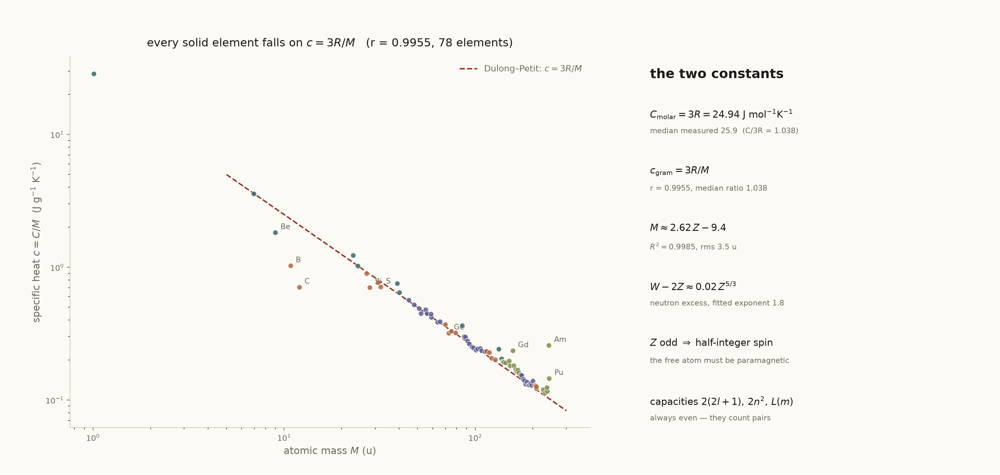

# The property layer, and what 1·3·7·9 means in the elements

## 1. Two laws, both universal

> **Now usable, and labelled.** The three readings of this number — per mole, per gram, per unit volume —
> are the density triangle `M = D·V` with heat in place of mass, and each reading is a Lean `↔`:
> [`specific-heat-bridge.md`](specific-heat-bridge.md) (labels H1–H9) and
> [`specific-heat.lean`](specific-heat.lean). The third reading, $\rho c = 3R/V_m$, is exact and one
> column (density) short of being tested; the countdown $h$ does *not* order this property (within the
> p block $\mathrm{Spearman}=+0.02$, within d $-0.07$), which is the label that stops the false reading.

**The elements' specific heat is a constant per mole.** Dulong–Petit, tested on the 78 elements that
carry a molar heat capacity in the data:

$$C_{\rm molar}\approx 3R = 24.94\ \mathrm{J\,mol^{-1}K^{-1}},\qquad
\text{median measured }25.9,\ \ C/3R=1.038 .$$

72% of elements sit within ±10%; the ones that do not are the quantum solids, all with $C/3R$ far
*below*: C 0.30, B 0.40, Be 0.70, Si 0.80, S 0.90 — the light, hard, high-frequency lattices.

**Per gram it becomes a prediction from the scale's mass column:**

$$c_{\rm gram}=\frac{C}{M}\approx\frac{3R}{M},\qquad r=0.9955,\ \ \text{median ratio }1.038 .$$

| element | $M$ | $3R/M$ predicted | measured $c$ | error |
|---|---|---|---|---|
| Fe | 55.85 | 0.4466 | 0.4495 | +0.6% |
| Cu | 63.55 | 0.3925 | 0.3846 | $-2.0\%$ |
| Au | 196.97 | 0.1266 | 0.1291 | $+2.0\%$ |
| Pb | 207.2 | 0.1204 | 0.1286 | $+6.8\%$ |
| C | 12.01 | 2.076 | 0.709 | $-66\%$ (quantum solid) |

**And the mass itself is a line in $Z$:**

$$M \approx 2.62\,Z-9.4\quad (R^2=0.9985,\ \text{rms }3.5\ \mathrm{u}),\qquad W-2Z\ \text{grows as } Z^{5/3}
\ (\text{fitted exponent }1.8),$$

the second term being the neutron excess. So the whole property is: $c = 3R/(2.62Z-9.4)$ to a few per
cent, with the quantum solids as the named exceptions.

**The parallel with the primes is exact in form.** The segments have a coefficient $c=1/(2C_2)=0.75739$
— energy per unit $\log^2 p$, with the air carrying a $-2$ (the half-pair) — constant to $0.05\%$
across four decades. The elements have $3R$ — energy per kelvin per
mole — constant across the table. Both are *one number per unit*, and the per-unit value is universal;
everything that varies is the unit (the segment's $\log^2p$, the element's mass).

## 2. What 1·3·7·9 is in the elements

The four digits are the residues coprime to 10. In the primes they are the only residues a prime can
take; in the elements they never appear as a capacity. Both are arithmetic:

| | primes | elements |
|---|---|---|
| the odd alphabet | $p\equiv1,3,7,9\pmod{10}$ | $Z$ odd — digits $1,3,5,7,9$ |
| what it counts | **one prime** — a single unit | **one electron** — $Z$ itself |
| the even alphabet | gaps $\equiv0,2,4,6,8\pmod{10}$ | capacities $2(2l+1)$, $2n^2$, $L(m)$, closures — **all even** |
| why | a difference of two odd numbers is even | every capacity counts pairs: electrons pair, spins pair |
| what it decides | twin capability: $\{1,7,9\}$ open, $\{1,3,9\}$ close | $Z$ odd $\Rightarrow$ half-integer spin $\Rightarrow$ the free atom **must** be paramagnetic |

Check on the data: of the 118, 59 have odd $Z$; every closure is even (2, 10, 18, 36, 54, 86, 118 → end
digits 2,0,8,6,4,6,8); every block width ends in an even digit; every period length ends in an even
digit. **No capacity in either table can end in 1, 3, 7 or 9.**

And the digits carry nothing beyond that. Against the Dulong–Petit residual,
$\text{Spearman}(\text{digit},\text{resid}) = +0.059$ ($p=0.61$); splitting by parity gives
$C/3R = 1.082$ (odd $Z$) against $1.027$ (even), a 1.5σ difference — no effect. So the digit is a *label*,
and the only content it has is the parity of the unit count.

The one-line answer: **1, 3, 7 and 9 are the digits of a single unit.** In the primes that unit is a
prime, in the elements it is an electron; and because a difference of two units is even and a capacity
counts pairs, everything built *between* units — gaps, widths, closures, rungs — lands on the other five
digits, 0, 2, 4, 6, 8.

## 3. The tables

* [`tableO_element_properties.csv`](tableO_element_properties.csv) — all 118 elements with both
  coordinates $(m,h)$, block, group, mass, molar heat, $C/3R$, specific heat per gram, EN, $IE_1$, radius.
* [`tableN_universal_scale.csv`](tableN_universal_scale.csv) — the scale's own columns.
* [`chain-table.md`](chain-table.md) — the Chain Table, C1–C16.
