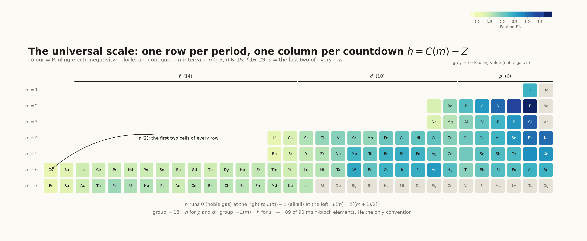

# A universal scale of elements: the countdown $h$

## 1. The coordinate

For an element of period $m$ and atomic number $Z$, let $C(m)$ be the period's closing number
(the noble gas: 2, 10, 18, 36, 54, 86, 118) and define

$$h \;=\; C(m)-Z,$$

the **countdown** — how many electrons the table still needs before the shell closes. $h=0$ is a noble
gas, $h=1$ a halogen, $h=2$ a chalcogen, and the first element of the period has the largest $h$. The
period length is

$$L(m)=2\Big\lceil \tfrac{m+1}{2}\Big\rceil^2 \qquad (2,8,8,18,18,32,32),$$

so $h$ runs from $L(m)-1$ down to $0$ and the pair $(m,h)$ is a relabelling of $Z$ — a two-integer
coordinate instead of a one-integer count.

## 2. The blocks are intervals of $h$ — exactly

| block | $h$ interval | width | period 4 example | period 6 example |
|---|---|---|---|---|
| $p$ | $0\le h\le5$ | **6** | Ga…Kr | Tl…Rn |
| $d$ | $6\le h\le15$ | **10** | Sc…Zn | Lu…Hg |
| $f$ | $16\le h\le29$ | **14** | — | La…Yb |
| $g$ | $30\le h\le49$ | **18** | — | — |
| $s$ | $L-2\le h\le L-1$ | **2** | K, Ca | Cs, Ba |

Zero exceptions in 118. The block widths $2(2l+1)$ are the **lengths of these intervals**, and the order
away from the closure is $p,d,f,g$, with $s$ at the head of the row. That is why the closure grid looks
the way it does: with the $f$ block left inline, every block is a clean column range (the arrangement
known as Janet's left-step table). The Chain Table's own claim — that the blocks are rectangles of width
$2(2l+1)$ — is the same statement.

## 3. The group is a one-line function of $h$

$$\text{group}=\begin{cases}18-h, & p\ \text{and}\ d\ (0\le h\le15)\\[2pt] L(m)-h, & s\ (h=L-2,\,L-1)\end{cases}$$

which reproduces the tabulated group for **89 of 90** $s/p/d$ elements; the single exception is He, which
the convention puts in group 18 while the formula gives 2. And the rung of the last-filled subshell is

$$q=\begin{cases} m, & s\\ m+1, & p,d,f\end{cases}$$

— one line connecting the Chain Table's index to the chemical period.

## 4. The chemistry runs along $h$

Mean Pauling electronegativity by countdown (main group, $n=40$):

| $h$ | 0 | 1 | 2 | 3 | 4 | 5 | 6 | 7 | 16 | 17 | 30 | 31 |
|---|---|---|---|---|---|---|---|---|---|---|---|---|
| mean EN | 2.60 | **2.99** | 2.53 | 2.30 | 2.06 | 1.77 | 1.44 | 0.96 | 0.97 | 0.82 | 0.90 | **0.79** |

$$\text{Spearman}(EN,h) = -0.922\ (p=3\times10^{-17}),\qquad \text{Spearman}(EN,m)=-0.356$$

and the same for the first ionisation energy: $-0.893$ against $h$, $-0.538$ against $m$. **$h$ is the
dominant chemical coordinate; the period is the correction.** A two-term fit:

$$EN \approx 1.52+0.102\,g-0.169\,m \qquad (R^2=0.83,\ \text{rms }0.33),$$
$$IE_1 \approx 1239+26.7\,g-155\,m \quad (R^2=0.51,\ \text{rms }301\ \mathrm{kJ/mol}),$$

with $g$ the group derived above. Atomic radius instead follows $m$ (72 → 183 pm across periods 1–7) —
size down the rows, electronegativity across them, exactly as the scale's two axes say.

## 5. What the scale unifies

| | Chain Table | universal scale |
|---|---|---|
| index | rung $q=n+l$ | countdown $h=C(m)-Z$ |
| blocks | widths $2(2l+1)$ | $h$-intervals of the same lengths |
| digits | 2, 6, 0, 4, 8 by block | inherited: $p$ 6, $s$ 2, $d$ 0, $f$ 4, $g$ 8 |
| capacity | $2n^2$ per shell | $L(m)$ per period |
| exceptions | 19 exchange promotions | the same 19 |
| what it predicts | the fill order | group (89/90), EN ($-0.92$), $IE_1$ ($-0.89$) |

Data for all 118 elements with both coordinates and the properties:
[`tableN_universal_scale.csv`](tableN_universal_scale.csv).

## 6. Limits

The scale is a **relabelling** of $Z$ — no element is predicted that is not already known — so its value
is that the two coordinates are the ones chemistry reads: $m$ for size, $h$ for valence. The group rule
is exact except for He; the EN fit leaves $\pm0.33$ Pauling units, which is the transition-metal-free
main group only; the $d$ and $f$ blocks have no such clean gradient (the middle of the table is where
the countdown stops working and the occupancy starts). Anything stronger would need the occupancy
$k$ as a third coordinate, which is the Chain Table's fifth column, not this scale's second.
