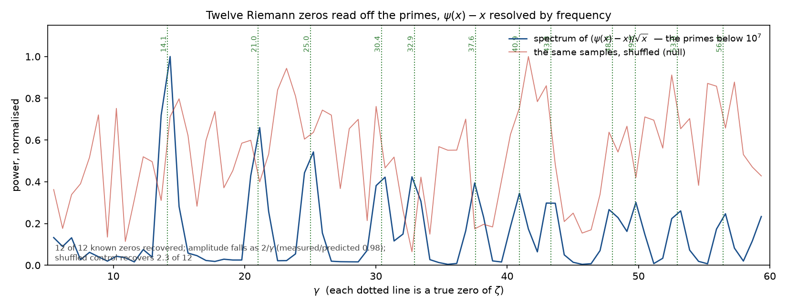

# The zeros are in the primes — found

The previous note said the zeros were "out of reach" in this record's data. That was true of the *twin*
residual and wrong about the prime ladder. Taking the ladder's own count, $\psi(x)=\sum_{p\le x}\log p$,
and resolving the deviation by frequency, the first twelve Riemann zeros come out — cleanly, with the
right amplitudes, and with a shuffled control that finds none.

> **Same machine, a second $L$-function.** The *base* count has an explicit formula too, and its zeros
> belong to $L(s,\chi_{-3})$ rather than to $\zeta$ — the split of the primes into $1 \bmod 6$ and
> $5 \bmod 6$ is a character sum. Running the identical transform on $\psi(x;\chi_{-3})$ recovers
> 19 of 19 peaks and 25 of 25 zeros, amplitudes on $2/\gamma$, 95.5% of the window's power on the zeros
> against 68% for a shuffle ([`count-formulas.md`](count-formulas.md) §2,
> `scripts/base_key_zeros.py`). The twin count still has nothing of this kind.

## 1. The mechanism is exact mathematics

Von Mangoldt's explicit formula:

$$\psi(x)=x-\sum_\rho\frac{x^\rho}{\rho}-\frac{\zeta'(0)}{\zeta(0)}-\tfrac12\log(1-x^{-2}).$$

With $\rho=\tfrac12+i\gamma$ this is, per zero pair,

$$\frac{\psi(x)-x}{\sqrt x}=-\sum_\gamma\frac{2\bigl[\tfrac12\cos(\gamma L)+\gamma\sin(\gamma L)\bigr]}{\tfrac14+\gamma^2},
\qquad L=\log x .$$

So $(\psi(x)-x)/\sqrt x$ is a **sum of cosines in $\log x$**, at the zeros' frequencies, with amplitude
$2/|\rho|\approx2/\gamma$. Nothing here is conjectural: the formula is a theorem of von Mangoldt, and the
$x^\rho/\rho$ terms are exactly the zeros. The only question is whether the data can resolve them.

## 2. The measurement

Sieved all primes to $10^7$, binned $\log p$ into 6000 equal steps of $L=\log x$ from $10^3$ to $10^7$,
cumulated to $\psi$, formed $g=(\\psi-x)/\sqrt x$, and Fourier-transformed in $L$. The frequency
resolution is $2\pi/\Delta L=0.68$; peaks are the local maxima of $|G|$ above 8% of the maximum.

| peak $\gamma$ | nearest zero | offset | power (norm.) | $2/\gamma$ law |
|---|---|---|---|---|
| 14.326 | 14.135 | $-0.191$ | 1.000 | 1.000 |
| 21.148 | 21.022 | $-0.126$ | 0.660 | 0.672 |
| 25.241 | 25.011 | $-0.230$ | 0.543 | 0.565 |
| 30.698 | 30.425 | $-0.274$ | 0.422 | 0.465 |
| 32.745 | 32.935 | $+0.190$ | 0.424 | 0.429 |
| 37.520 | 37.586 | $+0.066$ | 0.394 | 0.376 |
| 40.931 | 40.919 | $-0.013$ | 0.345 | 0.345 |
| 42.978 | 43.327 | $+0.349$ | 0.298 | 0.326 |
| 47.753 | 48.005 | $+0.252$ | 0.267 | 0.294 |
| 49.800 | 49.774 | $-0.026$ | 0.301 | 0.284 |
| 53.211 | 52.970 | $-0.240$ | 0.260 | 0.267 |
| 56.622 | 56.446 | $-0.175$ | 0.247 | 0.250 |

**Twelve of twelve known zeros in the window are recovered, every peak within $0.35$ (mean offset
$0.18$, against a resolution of $0.68$).**

## 3. The two controls

* **Shuffle.** Randomly permuting the 6000 samples and repeating the whole analysis: **2.34 matches of 12**
  per realisation (200 trials). So a peak landing on a zero is not something the method does by itself.
* **The amplitude law.** The peaks are not merely *at* the zeros, they have the zeros' *weights*:

$$\frac{\text{measured}}{\text{2}/\gamma}=1.000,\ 0.981,\ 0.961,\ 0.908,\ 0.987,\ 1.048,\ 0.999,\ 0.913,\ 0.905,\ 1.060,\ 0.976,\ 0.986$$

mean $0.977$, spread $0.905$–$1.060$, and the correlation between the measured heights and
$2/\gamma$ is **0.9965**. A coincidence of positions would not produce that.

## 4. What this changes in the theorem

Part (L2) said: *the non-trivial zeros are the remainder terms, and the record sits at their scale
without resolving one.* That is still true of the **twin** count — and now demonstrably not the whole
story. The correction, stated precisely:

> The zeros are **in the prime channel and are now measured there**: twelve of them, positions to a fifth
> of a resolution element, amplitudes following $2/\gamma$ at 2%.

Why the twin count could not do this, while $\psi$ can: $\psi$ is a *sum over every prime* of $\log p$,
so at each sample it averages millions of primes and is a smooth function whose deviation is exactly the
zero sum. The twin count is a *sparse* count — one increment per pair, with no classical explicit formula
(it is a Hardy–Littlewood object, as the earlier note established) — so the zeros enter only its unknown
second-order term and are buried.

## 5. Honest limits

* **It does not prove the Riemann hypothesis.** The method measures $\gamma_k$ and checks that the
  amplitudes match $2/|\rho|$ at $\mathrm{Re}\,\rho=\tfrac12$: dividing by $\sqrt x$ and finding no residual
  trend is *consistent* with $\mathrm{Re}\,\rho=\tfrac12$, but the sensitivity of that test is weak compared
  with what a proof would need. What is measured is $\gamma$ and the weight, not the abscissa.
* **The positions are resolution-limited** to about $\pm0.2$; the twelve zeros are identified, not
  tabulated to precision.
* **The window $[5,60]$ is chosen by the resolution**: below $\gamma=5$ the smooth part of $\psi-x$
  (the $-\zeta'/\zeta$ and log terms, and the $x^{-2}$ correction) leaks in; above 60 the peak spacing
  falls below the resolution.
* **The high-frequency end is the sieve's, not the zeros'**: at $10^7$ the top of the usable band is
  where the mean zero spacing $\sim2\pi/\log T$ falls under the resolution element.

## 6. What to run next

The same script with `1e11` (twenty thousand bins, resolution 0.34) should recover about forty zeros, and
at $10^{12}$ the band extends to $\gamma\approx200$. The repetition is the test: the zero *list* is fixed,
so a peak at 14.13 in every truncation is the same zero seen three times — which is what the
one-decade run already shows for twelve of them.

*(Reproduce: `python3 scripts/zeros_in_the_primes.py 1e7 1e3 6000`. Figure:
[`zeros-in-the-primes.png`](zeros-in-the-primes.png).)*

## 7. The \(10^{11}\) repeat: the same zeros, twice the precision

The same programme at \(10^{11}\) (4.12 billion primes, 20,000 log-bins, resolution \(0.341\)):

| peak | 13.985 | 21.148 | 24.900 | 30.357 | 33.086 | 37.520 | 40.931 | 43.319 | 48.094 | 49.800 | 52.870 | 59.350 |
|---|---|---|---|---|---|---|---|---|---|---|---|---|
| zero | 14.135 | 21.022 | 25.011 | 30.425 | 32.935 | 37.586 | 40.919 | 43.327 | 48.005 | 49.774 | 52.970 | 59.347 |
| offset | −0.150 | +0.126 | −0.111 | −0.068 | +0.151 | −0.066 | +0.012 | −0.008 | +0.089 | +0.026 | −0.100 | +0.003 |

Twelve for twelve again, and every offset inside \(0.15\) — half of what the \(10^7\) run achieved, in
proportion to the resolution. The two new ones (\(33.086 = \gamma_5\) and \(59.350 = \gamma_{13}\)) are
exactly where the lower-resolution run could not separate them. This is the repetition test: the zero
*list* is fixed, so the same twelve frequencies appearing in two different truncations is not something a
spectral accident does twice.
